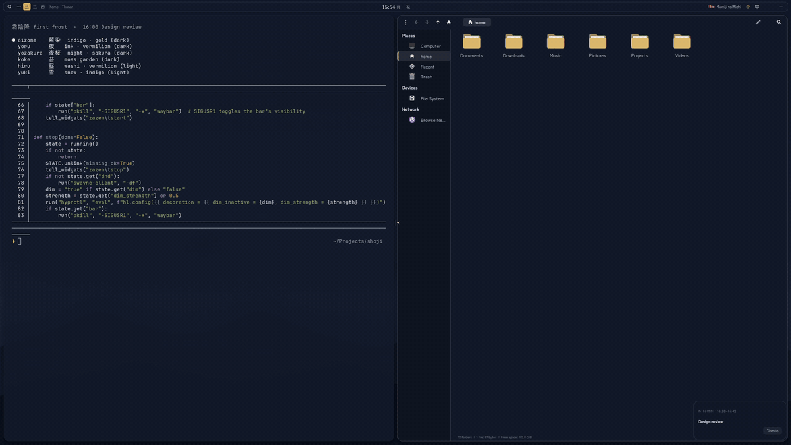
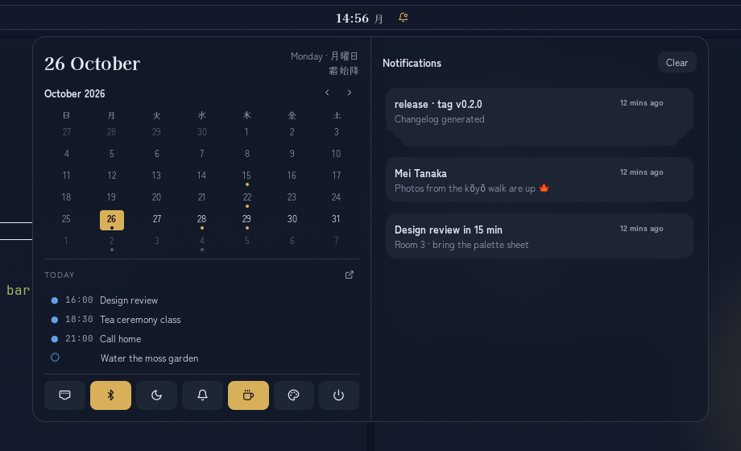
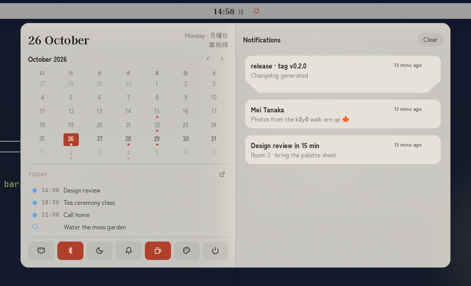
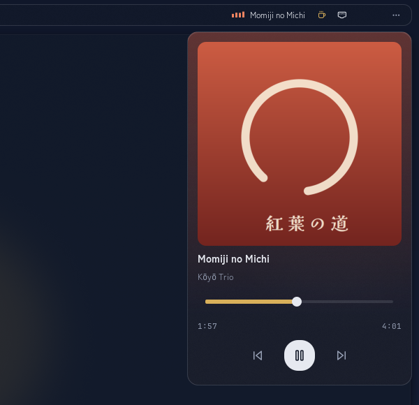
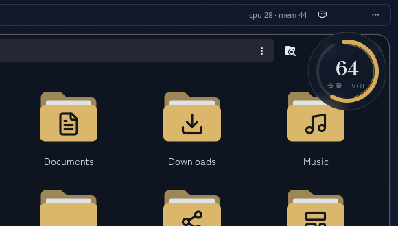
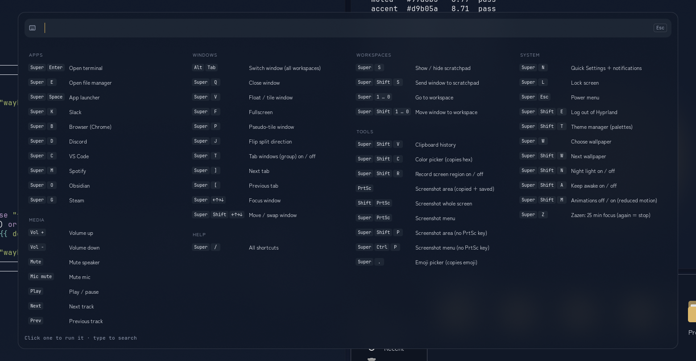
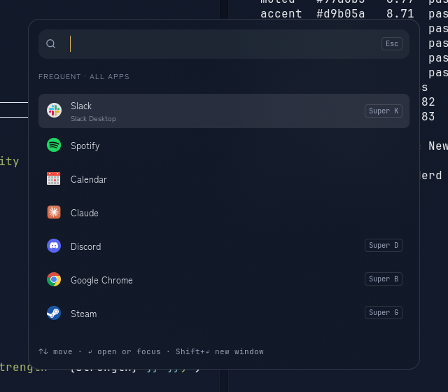
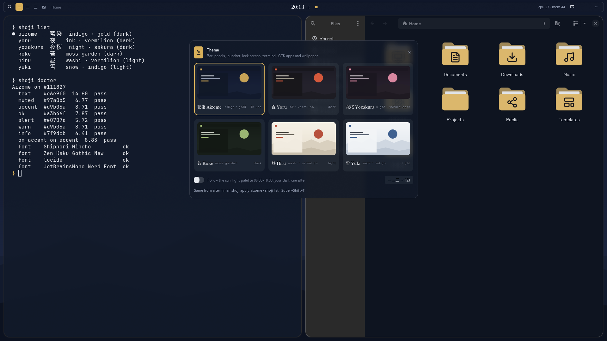
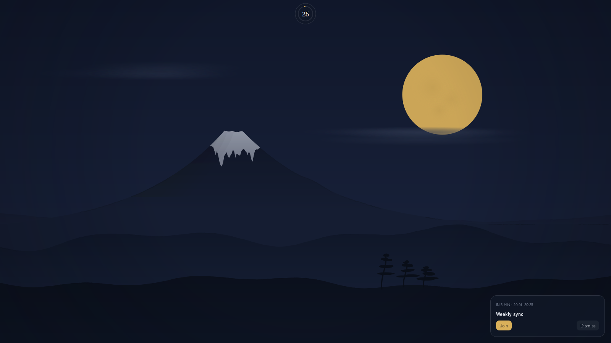
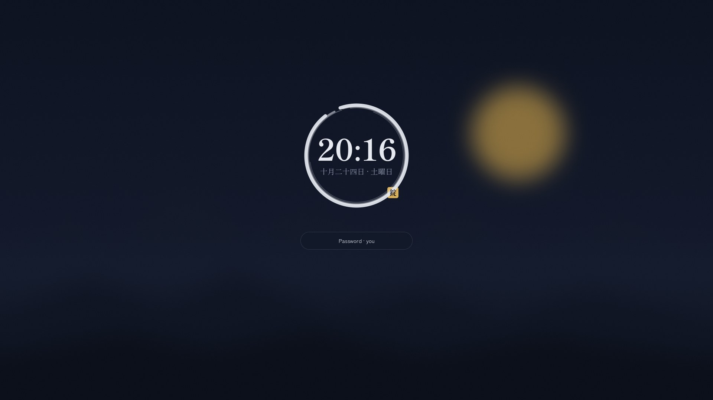

# Shoji 障子

[](https://github.com/andriar/shoji/actions/workflows/ci.yml)

**A calm, Japanese-inspired desktop for [Hyprland](https://hypr.land): light through paper.**

One palette drives everything you see: the bar, the panels, launcher, lock screen, terminal,
GTK and Qt apps, folder icons, the wallpaper, even VS Code and Spotify. Eight palettes, all of
them checked to WCAG 4.5:1 (two of them to 7:1).


The look follows three old ideas. **Kanso** (簡素): show a thing only while it matters, so the
cpu meter, the mic and the notification bell stay quiet until they have something to say.
**Ma** (間): empty space is part of the design. **Shibui** (渋い): one accent colour, and it only
means "you are here" or "this is on".

## A tour

In motion: Koyomi, now playing, the launcher, the ensō OSD and a zazen session (17 s).



| Koyomi: calendar, agenda, toggles and notifications | The same panel on Hiru (washi) |
|---|---|
|  |  |

| Now playing | Ensō OSD |
|---|---|
|  |  |



| Launcher | Theme manager |
|---|---|
|  |  |

| Zazen (focus) | Lock screen |
|---|---|
|  |  |

## What you get

**The bar**
- Workspaces as 一 二 三 四 (the current one sealed in the accent), the time with the weekday in
  kanji, a bell that gets a dot when something is unread.
- Now playing: the title with four bars that move while music plays, tinted with the cover's colour
  (smooth CSS animation, no polling per frame). Click for the Media popover.
- Readings appear only when they need you: cpu · mem from 70 %, a Bluetooth device's battery from
  20 % down (headphones, mouse), indicators only while on.

**Koyomi (暦), under the clock**
- One container: the calendar, today's micro-season (七十二候, e.g. 霜始降 "first frost") and the
  weather in one kanji (晴 曇 雨 雪 霧 雷, 月 on a clear night, from Open-Meteo), the day's
  events and due tasks (whatever GNOME Calendar shows, Google included), quick toggles that show
  their state (right-click Bluetooth for your devices and their battery), and notifications beside it.
- Notifications stack per app like iOS; clicking one takes you to its window and workspace.

**Calm on purpose**
- **Zazen** (Super+Z): 25 minutes of focus. Silent, no bar, other windows dimmed, an ensō closes
  at the top. At the end everything comes back, you hear how many notifications waited, and a
  5-minute rest (休) follows; Koyomi counts the day's sessions (座 ×3).
- **墨 Ink** when you step away: after 8 idle minutes the desktop sinks into the palette's ground
  and slow drops of ink bloom on it, the time and the day's 候 in a corner; any input brings the
  desktop back, the lock follows at 10 (`config/hypr/hypridle.conf`, `shoji-ink preview`).
- **Ensō** for volume, mic and brightness, shown even with Do Not Disturb on.
- **Rin (鈴)**: a small synthesised temple bell for critical notifications only.
- **Quiet in meetings**: Silent turns itself on while a calendar event runs or the screen is shared,
  and off after, with a note of what waited. Ten minutes before an event a card offers **Join**
  when it carries a Meet / Zoom / Teams link.
- **Seasonal accent** (optional): 紅梅 spring, 青竹 summer, 紅葉 autumn, 白群 winter.
- **Wallpaper**: ink-wash mountains under the sun (light palettes) or tonight's real moon phase; the sky
  turns pink at dawn, gold before sunset and violet after it (夕暮れ, from your city's sun times).

**Everyday tools**
- **Launcher** (Super+Space): frequent apps first; Enter focuses an app that is already open.
- **Shortcuts sheet** (Super+/): every bind, aligned in columns; click to run, type to search.
- **Instant terminal**: a ghostty window in ~20 ms (`hypr-term`).
- **Alt+Tab**: window cards with their app icon, title and workspace, most recent first; hold Alt,
  Tab to move, let go to switch (a quick tap jumps to the previous window).
- **Clipboard history** (Super+Shift+V): newest first, search, Enter to copy back, a delete button on
  every entry (or Del), and Clear all (asks once more); images show as thumbnails.
- **Screenshots** (PrtSc): copied and saved, then a small card in the corner with the picture and
  Open / Folder / Delete; it leaves by itself after 6 s.
- **Tabbed windows** (Super+T) as paper tabs; **one key per app** (Super+K Slack, Super+B browser…).
- **Theme manager** (Super+Shift+T): six palettes, follow the sun, and **your own**: pick a ground and
  an accent from traditional colours (or any hex); contrast is checked live and the rest is derived.

**Everything in one palette**
- GTK3 apps (Thunar first), Qt (qt6ct), ghostty, starship, btop, fzf, bat, delta, fuzzel, hyprlock,
  wlogout, Shoji's own folder icons, and themes for **VS Code, Spotify (spicetify) and Chrome**.
- **Six palettes**: 藍染 Aizome (indigo · gold, default), 夜 Yoru (ink · vermilion), 夜桜 Yozakura
  (night · sakura), 苔 Koke (moss), 昼 Hiru (washi, light), 雪 Yuki (snow, light), and two at high
  contrast (WCAG AAA, 7:1): 墨 Sumi (ink) and 白 Shiro (paper).

## Install

**Quick install** (Ubuntu 24.04 tested): fetch the bootstrap of a release, check it, run it. It clones
the release to `~/shoji` and runs the installer, which backs up everything it replaces.

```sh
curl -fsSLo /tmp/shoji-bootstrap.sh https://raw.githubusercontent.com/andriar/shoji/v0.5.0/bootstrap.sh
echo "6c2d10d6fa81149c8e537e75593544adbb1145a59c38821f15b8aaf25471cb11  /tmp/shoji-bootstrap.sh" | sha256sum -c \
  && sh /tmp/shoji-bootstrap.sh            # optional: a palette name, e.g. sh /tmp/shoji-bootstrap.sh yoru
```

Then add the Hyprland lines (step 3 below). On Arch, `packaging/aur/PKGBUILD` builds a package that
puts Shoji in `/usr/share/shoji` with a `shoji-setup` command (not on the AUR yet, and not yet tested
on Arch). The steps below do the same by hand.

### 1. Dependencies

Shoji needs Hyprland, waybar, swaync, fuzzel, hyprlock, PipeWire, NetworkManager, Python 3 with
GTK 3 + gtk-layer-shell bindings and cairo, and one wallpaper tool (awww, hyprpaper or swaybg).

Ubuntu / Debian (Hyprland itself from your usual source):

```sh
sudo apt install waybar sway-notification-center fuzzel hyprlock hyprpaper wireplumber \
  pulseaudio-utils network-manager python3-gi python3-cairo gir1.2-gtk-3.0 \
  gir1.2-gtklayershell-0.1 papirus-icon-theme curl fontconfig
```

Arch (package names; Shoji has not been tested on Arch yet):

```sh
sudo pacman -S hyprland waybar swaync fuzzel hyprlock hyprpaper wireplumber libpulse \
  networkmanager python-gobject python-cairo gtk3 gtk-layer-shell papirus-icon-theme curl
```

Optional: `ghostty` and `starship` (terminal colors and the `❯` prompt), `btop`, `qt6ct`,
`brightnessctl` and `power-profiles-daemon` (laptops: brightness ensō, battery popover),
`playerctl` (now playing on the bar: cover, bars that move while music plays, Media popover).
For the Koyomi agenda: `gir1.2-ecal-2.0` (Arch: `evolution-data-server`) plus `gnome-calendar`
and GNOME Online Accounts for Google calendars and tasks. Without it the calendar shows no agenda.

### 2. Run the installer

```sh
git clone https://github.com/andriar/shoji ~/shoji
~/shoji/install.sh            # or: ~/shoji/install.sh yoru
```

It backs up every file it replaces (`~/.local/share/shoji/backup-*.tar.gz`), downloads the fonts
(Kaisei Opti, Zen Kaku Gothic New, Lucide), installs the scripts to `~/.local/bin`, generates
the configs and applies a palette. It keeps your `starship.toml`; run with `SHOJI_PROMPT=1` to use
the Shoji prompt.

### 3. Add the Hyprland lines

The installer does not touch your Hyprland config. Copy the block for your config format
(Lua for 0.55+, or `hyprland.conf`) from [docs/hyprland.md](docs/hyprland.md): autostart, blur,
window hairlines and the keys. Check it with `Hyprland --verify-config`, then log out and back in.

### Optional: terminal tools

`bat`, `delta` and `fzf` keep their own themes, so a dark theme like Catppuccin Mocha is unreadable
on Hiru and Yuki. Point them at Shoji and they follow every palette switch:

```sh
# ~/.zshrc or ~/.bashrc: fzf colors and BAT_THEME=ansi (bat uses the 16 terminal colors)
[ -f ~/.config/shoji/shell.sh ] && source ~/.config/shoji/shell.sh
```

```ini
# ~/.gitconfig: delta diff colors from the palette
[include]
	path = ~/.config/shoji/delta.gitconfig
[delta]
	features = shoji
```

Apps that draw with fixed RGB colors need their own light/dark setting. Claude Code's `dark` theme
writes white text, which disappears on Hiru and Yuki: run `/theme` and pick **Auto (match terminal)**
(`"theme": "auto"` in `~/.claude/settings.json`). It reads the terminal background, so it follows
every palette.

### Optional: Thunar

Thunar opens in ~140 ms (Nautilus takes ~1 s cold) and ~45 ms with its daemon. For the Shoji look,
use breadcrumbs and the ⋮ menu instead of the menu bar (Ctrl+M brings it back):

```sh
xfconf-query -c thunar -p /last-location-bar -n -t string -s ThunarLocationButtons
xfconf-query -c thunar -p /last-menubar-visible -n -t bool -s false
xdg-mime default thunar.desktop inode/directory   # folders from other apps open in Thunar
```

Start `thunar --daemon` at login and bind your file-manager key to `thunar`.

### Optional: app themes

Every `shoji apply` also writes themes for the apps you spend the day in. Turn each on once:

| App | Once | After that |
|---|---|---|
| VS Code | `shoji vscode`, then Ctrl+K Ctrl+T → Shoji | follows each palette switch (Reload Window if it lags) |
| Spotify ([spicetify](https://spicetify.app)) | `shoji spotify`, then `spicetify apply` (restarts Spotify) | the colour scheme is set; run `spicetify apply` when convenient |
| Chrome | `shoji chrome`: load the printed folder unpacked in chrome://extensions | press the extension's reload button |

### Optional: notification stacks

swaync 0.10+ stacks notifications per app (like iOS: one card, tap to expand). Ubuntu 24.04 ships
0.9, so build 0.11.0, the last GTK3 release (0.12 needs GTK 4.16 and newer libraries than 24.04
has). Installing to `/usr/local` puts it ahead of the packaged one in PATH; the package stays.

```sh
sudo apt install valac meson sassc scdoc libhandy-1-dev libgranite-dev libjson-glib-dev libpulse-dev
curl -L https://github.com/ErikReider/SwayNotificationCenter/archive/refs/tags/v0.11.0.tar.gz | tar xz
cd SwayNotificationCenter-0.11.0
meson setup build --prefix=/usr/local -Dsystemd-service=false -Dman-pages=false \
  -Dzsh-completions=false -Dbash-completions=false -Dfish-completions=false
patch -p1 < ~/shoji/docs/patches/swaync-0.11.0-shoji-motion.patch   # optional: Shoji's motion
ninja -C build && sudo ninja -C build install    # undo: sudo ninja -C build uninstall
pkill -x swaync; swaync &                         # restarting clears current notifications
```

Shoji's swaync theme styles the stacks (an opaque fill for collapsed cards, so the ones behind
do not show through). The optional patch puts swaync on Shoji's motion scale: the mouse wheel glides through the list
(ease-out, 180 ms per notch, quick notches add up) instead of jumping, and group animations take
180 ms instead of 400. Touchpads keep GTK's own scrolling.

### Uninstall

```sh
~/shoji/uninstall.sh
```

Restores the backup. Remove the Shoji lines from your Hyprland config, then log out and in.

## Use

| Keys | |
|---|---|
| `Super+Space` · `Super+/` | launcher · every shortcut (type to search) |
| `Super+Enter` · `Super+E` | terminal (instant) · Thunar |
| `Super+N` or click the clock | Koyomi: calendar, agenda, toggles, notifications |
| in Koyomi (click it) | ← → day · ↑ ↓ week · PgUp/PgDn month · Home today · Enter open · Esc close |
| `Super+Z` | zazen: 25 minutes of focus (again = stop) |
| `Super+T` · `Super+[` / `]` | tab windows · previous / next tab |
| `Super+Shift+T` | theme manager |
| `Super+Shift+M` | reduced motion: Hyprland, GTK and Shoji stop animating (again = back) |
| `PrtSc` / `Super+Shift+P` | screenshot an area (`Super+Ctrl+P`: the screenshot menu) |
| volume keys, keyboard knob | ensō OSD |

| From a terminal | |
|---|---|
| `shoji apply koke` · `shoji list` | switch palette · list them |
| `shoji doctor` | contrast and font check for the current palette |
| `shoji doctor --deps` | what is installed, and what each missing piece would add |
| `shoji vscode` · `shoji spotify` · `shoji chrome` | turn on an app theme (once) |
| `shoji greet` · `shoji season` · `shoji moon` | today's 候 and what is next · the season · redraw the moon |

Preferences live in `~/.config/shoji/prefs.json`: `"seasonal"`, `"follow_sun"`, `"weather"` (`false`,
or `{"place": "Kyoto"}`; default: the city of your time zone), `"greet"` (one dim
line in new terminals), `"rin"` (false = no bell), `"auto_silent"` (false = no Silent in meetings), `"reduced_motion"` (Super+Shift+M: nothing animates anywhere), `"numerals"` (`"kanji"` or `"arabic"`), `"lang"` (`"en"`, `"id"` or `"ja"`: the language of Koyomi and the popovers; the Language chip in the theme manager cycles it).

## Make your own palette

Easiest: Theme manager → **Your own** (saved in `~/.config/shoji/palettes.json`). By hand: add an entry to `PALETTES` in `bin/shoji` (ground, text, muted, accent, text-on-accent, and the
wallpaper sky and hills), then `shoji doctor <name>` to check contrast and `shoji apply <name>`.

## How it is built

- `bin/shoji` — the palettes and every generator: Hyprland, waybar, swaync, wlogout, fuzzel,
  hyprlock, ghostty, starship, btop, qt6ct, GTK 3/4 (with a full GTK3 layer for Thunar and friends),
  fzf, bat and delta colors, plus the wallpaper, ensō images and folder icons (cairo). `shoji apply`
  reloads everything that can reload and restarts Thunar on its folders.
- `bin/hypr-widgets` — one small GTK3 layer-shell process: ensō OSD, Koyomi, the popovers (Sound,
  Network, Battery, Media, Theme), launcher, shortcuts sheet and the zazen ensō. It also brings a
  clicked notification's window forward and keeps today's agenda cached for `shoji greet`.
- `widgets/shoji_widgets/` — hypr-widgets' surfaces as modules: `base` (palette, CSS, motion, Glide),
  `koyomi`, `popovers`, `overlays` (OSD, cards, meetings, zazen); installed to
  `~/.local/share/shoji/widgets`. Tests: `python3 -m unittest discover tests`.
- `bin/shoji-media` (now playing, picks the playing player), `bin/shoji-zazen` (focus sessions),
  `bin/shoji-ink` (the idle screen),
  `bin/shoji-ws` (workspace buttons, see below), `bin/hypr-sysload`, `bin/shoji-level`.
- `bin/hypr-term` — opens a terminal as a D-Bus action on the running ghostty;
  `bin/hypr-focus-or-launch` — one key per app.
- **Motion**: one scale everywhere: state changes 150 ms, content that moves (scrolling, slides,
  crossfades, toasts, shell surfaces) 180 ms, windows and workspaces 320 ms, all easing out with
  no springs. Hover and selection fade, the mouse wheel glides, the Koyomi month slides.
- `generators/` — the waybar and swaync configs, generated so icons and buttons match what is
  installed.
- `bin/shoji-ws` — workspace buttons for waybar. Its `hyprland/workspaces` module switches with
  `dispatch workspace N`, which Hyprland's Lua config rejects, so the buttons are custom modules that
  dispatch `hl.dsp.focus({ workspace = N })`.

## Status

Tested on Ubuntu 24.04 (Zorin OS 18) with Hyprland 0.56.2, waybar 0.14, swaync 0.9 and 0.11, and
hyprlock 0.9.6, including a clean-home install inside a nested Hyprland (the screenshots come from
one, with demo data) and two monitors there, one at scale 2 (Koyomi and the swaync panel re-centre on
whichever monitor has focus; wide sheets fit the screen). The PKGBUILD builds, installs and
uninstalls cleanly in an `archlinux` container (no Arch desktop session tried yet). Koyomi and the
popovers speak English, Indonesian and Japanese (prefs `"lang"`). The login screen
(`shoji greeter`, [docs/greeter.md](docs/greeter.md)) is written but not yet tried at a real login.
Not yet tested: swaync 0.12 (GTK4) and real laptops. Issues and screenshots welcome.

## License

Code: MIT (see LICENSE). Fonts keep their own licenses (SIL OFL for Kaisei Opti and
Zen Kaku Gothic New, ISC for Lucide) and are downloaded by the installer, not bundled.
Folder glyphs are Lucide icons (ISC).
